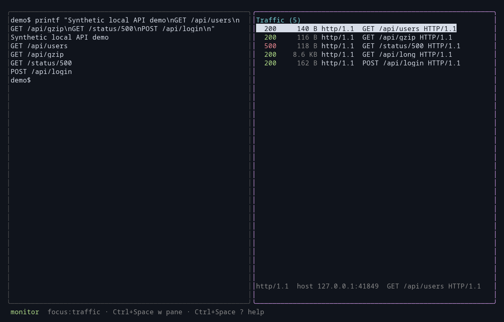

# cli-capture

**Burp Suite, but for CLI / TUI applications.**

> ⚠️ **This entire app was vibed out in an afternoon, bugs exist, issues help me fix them :)**

A split-pane terminal app that captures, inspects, and tampers with the network
traffic of a command-line program. The **left pane** is a real terminal running
your target CLI; the **right pane** is a live view of the HTTP(S), HTTP/2, gRPC,
and WebSocket traffic it generates — which you can pause, edit, drop, replay, and
export.

```
┌─ terminal (target) ─────────┐┌─ Traffic (54) ──────────────┐
│ $ gh pr list                ││   done   GET  /user         │
│ ...                         ││ ⚑ done   POST /graphql      │
│                             ││   PAUSED POST /v1/messages  │
│                             ││   active GET  /events/stream│
│                             ││                             │
│                             ││ ▶ POST /v1/messages         │
│                             ││ [e]dit  [f]orward  [d]rop   │
└─────────────────────────────┘└─────────────────────────────┘
 Ctrl+Space ? help · Ctrl+Space w switch pane · Ctrl+Space i intercept
```

**📸 See the [visual tour](docs/screenshots.md)** for a screenshot of every feature,
or the **[docs](docs/)** for the guides: [getting started](docs/getting-started.md) ·
[keybindings](docs/keybindings.md) · [scope](docs/scope.md) ·
[intercepting](docs/intercepting.md) · [repeater](docs/repeater.md) ·
[exporting](docs/exporting.md).



---

## What it's for

Browsers make traffic interception easy — you point them at a proxy and install
a cert. Command-line tools don't cooperate that nicely. cli-capture solves that:
it launches your target with its network environment rewritten so its traffic
flows through a local man-in-the-middle proxy, decrypts TLS, parses the common
protocols, and gives you a TUI to watch and modify it all in flight.

Use it to:

- see exactly what a CLI sends to its backend (headers, bodies, gRPC messages),
- **intercept and modify** requests or responses on the fly,
- **replay** a request, **export** it as curl / HAR / plain text,
- flag interesting requests during a run and export your shortlist.

## Features

- **Capture two ways** — proxy-env injection (no privileges) or transparent
  redirect (Linux, for apps that ignore `HTTP_PROXY`).
- **TLS MITM** — generates a local CA and mints leaf certs on the fly; the
  target trusts it automatically because the CA is injected per-launch.
- **Protocols** — HTTP/1.1, HTTP/2, gRPC, WebSocket, with a raw-TCP passthrough
  fallback so nothing is ever dropped.
- **Intercept & tamper** — pause matching flows and edit / forward / drop.
  Whole-body for HTTP/1 and unary HTTP/2, per-message for streaming gRPC,
  per-frame for WebSocket, plus live WebSocket frame **injection**.
- **Scope engine** — decide *what* to intercept and *what* to MITM with
  composable include/exclude rules across host, path, method, protocol, body.
- **Readable bodies** — gzip / deflate / br / zstd are decompressed, JSON is
  pretty-printed and syntax-highlighted, binary falls back to a hex dump.
- **Flag, filter, search** — mark interesting flows, filter to just those, or
  substring-search the list.
- **Replay & export** — resend a flow to its origin; export as curl, HAR 1.2, or
  plain text (single flow or all flagged).
- **Sessions** — save the complete capture to JSON. Loaded flows appear before new traffic arrives.
- **A real terminal** — the left pane is a full VT100/xterm emulator, so
  full-screen TUI targets render correctly.

---

## Install

### Homebrew (macOS / Linux)

```bash
brew install citizen-123/tap/cli-capture
```

Or tap first, then install:

```bash
brew tap citizen-123/tap
brew install cli-capture
```

Upgrade later with `brew upgrade cli-capture`.

### With `go install`

Requires **Go 1.26+**. Installs the `cli-capture` binary into `$(go env GOBIN)`
(or `$(go env GOPATH)/bin`):

```bash
go install github.com/citizen-123/cli-capture/cmd/cli-capture@latest
```

Make sure that directory is on your `PATH`, then run `cli-capture -version` to
confirm.

### Prebuilt release binaries

Grab a tarball/zip for your OS and architecture from the
[Releases page](https://github.com/citizen-123/cli-capture/releases) (linux,
macOS, and Windows on amd64/arm64), verify it against `checksums.txt`, and drop
the binary on your `PATH`:

```bash
# example: Linux amd64
tar -xzf cli-capture_*_linux_amd64.tar.gz
install -m755 cli-capture ~/.local/bin/
cli-capture -version
```

### From source

```bash
git clone https://github.com/citizen-123/cli-capture
cd cli-capture
go build -o cli-capture ./cmd/cli-capture
```

That produces a single static-ish binary `./cli-capture`. Move it onto your
`PATH` if you like (`install -m755 cli-capture ~/.local/bin/`).

Run the tests:

```bash
go test ./...            # or: go test -race ./...
```

## Quick start

```bash
./cli-capture -- curl https://example.com   # capture one command
./cli-capture                               # capture a whole $SHELL session
./cli-capture -shell -- claude-as alt       # target is a shell alias or function
```

Everything after `--` is the target command and its arguments. With no command
at all, cli-capture launches your `$SHELL` interactively — every command you run
inside it is captured. `-shell` runs a named target through `$SHELL -ic`, so
aliases, shell functions, and rc-file `PATH` entries resolve (`exec` alone sees
only `PATH` binaries). On first run it creates `~/.cli-capture/` (CA + config);
subsequent runs reuse it.

Press **`?`** at any time for the full keyboard reference.

### Why HTTPS "just works"

The target is launched with these environment variables injected, so
well-behaved clients route through the proxy *and* trust the MITM CA — for that
child process only, nothing system-wide:

| Variable(s) | Purpose |
|---|---|
| `HTTP_PROXY` `HTTPS_PROXY` `ALL_PROXY` | route traffic through the proxy |
| `SSL_CERT_FILE` `CURL_CA_BUNDLE` | trust the CA (OpenSSL, curl) |
| `REQUESTS_CA_BUNDLE` | Python `requests` |
| `NODE_EXTRA_CA_CERTS` | Node.js |
| `GIT_SSL_CAINFO` | git |

Tools that ignore proxy env (statically-linked binaries, raw sockets) won't be
caught this way — use **transparent mode** for those.

---

## CLI options

```
cli-capture [flags] -- <command> [args...]
cli-capture [flags]                          # target defaults to $SHELL
```

Everything after `--` is the target program to launch and monitor. Omit it
entirely and the target is an interactive `$SHELL`.

| Flag | Default | Description |
|---|---|---|
| `-shell` | off | Run the target through `$SHELL -ic` so aliases and shell functions resolve. |
| `-listen <addr>` | `127.0.0.1:0` | Proxy listen address. `:0` picks a free port. |
| `-dir <path>` | `~/.cli-capture` | Data directory: CA, sessions, exports, log. |
| `-config <files>` | `~/.config/cli-capture/config.json` | Config file(s) or preset name(s); repeatable and comma-separated, merged in order. See [docs/configuration.md](docs/configuration.md). |
| `-theme <name>` | `dark` | `dark`, `light`, `high-contrast`, or `none`. Overrides the config file. |
| `-scope <specs>` | *(all)* | Comma-separated specs for **which flows to intercept**. Default intercepts everything (once armed). |
| `-exclude <specs>` | — | Comma-separated specs to **never** intercept; wins over `-scope`. |
| `-last-match` | off | Evaluate all scope rules and take the last match instead of the first. |
| `-mitm <specs>` | *(all)* | MITM (decrypt) only these TLS hosts. |
| `-no-mitm <specs>` | — | Pass these TLS hosts through **without** decrypting (blind tunnel, still logged). |
| `-load <file>` | — | Preload a saved capture session (JSON) into the flow list. |
| `-leader <key>` | `ctrl+space` | Global prefix key. Supports `ctrl+a` through `ctrl+z`, except Tab and Enter. Explicit `ctrl+a` retains the old behavior. |
| `-transparent <addr>` | off | Also run a transparent-redirect listener at this address (Linux, needs root + nftables/iptables). |
| `-transparent-uid <uid>` | `-1` | The uid assigned to the launched target and matched by the redirect rule when `-transparent-apply` is used. |
| `-transparent-apply` | off | Actually install/remove the redirect rules (needs root); otherwise they're just logged for you to run. |

### Scope specs

`-scope`, `-exclude`, `-mitm`, and `-no-mitm` all take comma-separated **specs**
of the form `[!][field:]pattern`:

| Part | Values |
|---|---|
| `!` | negate the match |
| `field:` | `host` (default) · `path` · `method` · `proto` · `body` · `any` |
| `pattern` | `~regex` · `=exact` · contains `*`/`?` → glob · otherwise substring |

Examples:

```bash
# intercept only GitHub's API, minus a noisy endpoint
./cli-capture -scope '*.github.com' -exclude 'path:/telemetry' -- gh pr list

# pause every POST, and anything carrying a token in its body
./cli-capture -scope 'method:=POST,body:token' -- some-cli

# monitor everything, but never decrypt the bank
./cli-capture -no-mitm '*.bank.example' -- some-cli
```

Postures fall out of the defaults: give `-scope` and you get an **allowlist**
(intercept only those); give only `-exclude` and you get a **denylist**
(intercept everything except those). Specs within one flag are OR'd, and a flag
given twice keeps only the last value — see [docs/scope.md](docs/scope.md).

---

## Keybindings

The default global leader is **`Ctrl+Space`** (NUL). It works in every view,
including editors, prompts, Repeater, and help. Ordinary `Ctrl+A` reaches the
target unchanged.

Press **`Ctrl+Space ?`** for help. Press the leader twice to send its literal
byte from the terminal pane. Escape cancels a pending leader.

If the terminal or multiplexer captures Ctrl+Space, use `-leader ctrl+g`.
An explicit `-leader ctrl+a` restores the old leader. The flag overrides
`keys.leader` in the configuration. Help and footer hints use the effective
bindings. See [configuration](docs/configuration.md).

**Global — leader then:**

| Key | Action |
|---|---|
| `w` | switch pane (terminal ⇄ traffic) |
| `<` / `>` | shrink / grow the terminal pane |
| `i` / `r` | toggle intercept: requests / responses |
| `p` | inspect the active held message / return to the previous view |
| `c` | cancel the active resend or Repeater job |
| `s` | save session to JSON |
| `h` | export session as HAR |
| `f` | export flagged flows → `flagged.txt` |
| `m` | toggle mouse capture (off restores native text selection) |
| `?` | toggle help |
| `q` | quit |

With mouse capture on (the default), clicks move pane focus and select flows —
clicking the already-selected flow opens it — and the wheel scrolls the traffic
list or pages the hosted app. Toggle it off (`leader m`) to use your terminal's
own text selection and copy-paste.

**Traffic pane** (plain keys — it never forwards to the target):

| Key | Action |
|---|---|
| `j` / `k` | move selection (list scrolls to follow) |
| `space` | flag / unflag the selected flow |
| `F` | show flagged only |
| `o` | cycle sort: none / status / size (surfaces attack outliers) |
| `/` | filter by host / method / path / status |
| `enter` | open the detail view |
| `e` / `f` / `d` | edit / forward / drop the **active held message**, not the selected row |
| `x` | start an asynchronous resend to the selected origin |
| `c` | export the selected flow as a curl command |
| `n` / `N` | inject a WebSocket frame (client→server / server→client) |
| `?` | toggle help |

Traffic rows retain the protocol, HTTP status code, and response size before
clipping request text. The selected summary identifies the row. Detail shows the complete target.

**Repeater** (`R`): `Tab` cycles request, payload, and response focus.
`Ctrl+O` selects the attack mode. The planned request count appears before
`Ctrl+S` starts the job. Only one manual job runs at a time. Its progress and
global cancellation remain available after the Repeater closes.

**Detail view** (`enter`): `j`/`k` scroll, `v` switches expanded/raw display,
`s` exports text, and Escape returns. Resizing rewraps the content without losing
the bottom anchor. Preview limits are explicit. Session JSON retains complete
stored bytes.

**Editor**: `Ctrl+S` sends, `Ctrl+L` repairs HTTP/1 `Content-Length`, and Escape
leaves the message held. Unchanged sends and header-only edits preserve the
original body. `Ctrl+R` explicitly replaces a retained body with text.

---

## Intercepting & modifying

Interception is **off by default** — cli-capture only records until you arm it:

1. Press `Ctrl+Space i` to arm requests, or `Ctrl+Space r` to arm responses.
2. Wait for the held-message row. It identifies direction, flow, and queued count.
3. Press `Ctrl+Space p` to inspect the held message.
4. Press `e` to edit, `f` to forward, or `d` to drop that message.

New pauses do not change keyboard focus or discard drafts. Each decision
resolves one pause and restores the previous view.

HTTP/1 edits include headers and body. HTTP/2 and gRPC editors change only the
body. WebSocket interception uses requests for outbound data and responses for
inbound data. Successful injections (`n`/`N`) appear once with direction and
injection provenance.

## Transparent mode (Linux, root)

For targets that ignore `HTTP_PROXY`, redirect their traffic at the kernel level.
Choose an existing, dedicated non-root uid for the target:

```bash
# let cli-capture install & clean up the rules itself (opt-in, root only)
sudo cli-capture -transparent 127.0.0.1:8081 -transparent-uid 1500 -transparent-apply -- ./target
```

With `-transparent-apply`, cli-capture resolves that account's primary and
supplementary groups and launches only the target with those credentials.
cli-capture and its proxy retain their privileged identity, so the proxy's own
upstream connections do not match the uid redirect; `-transparent-uid 0` is
rejected because it would also redirect the root proxy. It auto-detects
**nftables** (preferred) or **iptables**, flushes stale
rules first, rolls back a partial apply, and removes the rules on exit (including
SIGINT/SIGTERM). Without `-transparent-apply` it does not change the target's
credentials and only logs the exact commands for you to run. The pre-redirect
destination is recovered via `SO_ORIGINAL_DST` (IPv4 and IPv6), then runs through
the same MITM/scope/intercept pipeline.

## Sessions & export

- **Session** — `Ctrl+Space s` writes all flows to `~/.cli-capture/session.json`;
  `-load <file>` reloads one (flags survive the round-trip).
- **curl** — `c` writes the selected flow's request as a curl command.
- **HAR 1.2** — `Ctrl+Space h` writes the whole session as `capture.har`.
- **Text** — `s` in the detail view writes the viewed flow to `flow-<id>.txt`;
  `Ctrl+Space f` writes all flagged flows to `flagged.txt`.

> Note: exports are verbatim — they include auth headers, cookies, and full
> request bodies (e.g. an app's system prompt). Treat the files as sensitive.

---

## Architecture

The load-bearing idea: keep **transport capture** (getting the bytes) separate
from **protocol parsing** (understanding them), so adding a protocol is one file
implementing `protocol.Protocol` plus one `Register` call.

```
cmd/cli-capture      entrypoint & wiring
internal/runner      PTY-hosted target + proxy/CA env injection
internal/terminal    full VT100/xterm emulator (vt10x) for the left pane
internal/proxy       HTTP CONNECT proxy + TLS MITM + HTTP/2 bridge
internal/proxy/ca    CA generation + on-the-fly leaf signing
internal/protocol    parsers: http/1.1, http/2, gRPC, websocket, raw tcp
internal/capture     Flow/Message model, thread-safe Store, session save/load,
                     Content-Encoding decompression
internal/intercept   pause/edit queue + live-session registry (scope via internal/scope)
internal/scope       composable match engine (field × strategy × include/exclude)
internal/replay      resend a captured HTTP/gRPC flow to its origin
internal/export      curl / HAR / plain-text rendering
internal/transparent Linux SO_ORIGINAL_DST + nftables/iptables redirect
internal/tui         bubbletea split-pane UI: editor, detail view, filter, help
```

After TLS termination the proxy branches by ALPN: `h2` goes through Go's
`http2.Server` ⇄ `ReverseProxy` ⇄ `http2.Transport` (streaming-safe); everything
else takes the byte-level `Protocol.Handle` path.

Built with [bubbletea](https://github.com/charmbracelet/bubbletea) /
[lipgloss](https://github.com/charmbracelet/lipgloss),
[creack/pty](https://github.com/creack/pty),
[hinshun/vt10x](https://github.com/hinshun/vt10x), and
[golang.org/x/net/http2](https://pkg.go.dev/golang.org/x/net/http2).

## Known limitations

- **HTTP/2 header editing** isn't wired — h2 modification is body-only (HTTP/1
  edits the full request/response).
- The editor is a **text** field, so editing binary/protobuf bodies is clumsy
  (JSON/text is fine).
- **HTTP/2 responses that are only observed** (not intercepted) are streamed
  without buffering, so their bodies aren't captured for the detail view.
- **Transparent mode** needs `CAP_NET_ADMIN`; its privileged redirect path can't
  be exercised without root, so it's less battle-tested than the proxy-env path.
- Some **native binaries** pin certs or read only the system trust store and
  won't honor the injected CA — transparent mode helps, cert pinning doesn't.

## Roadmap

- clipboard integration for curl export
- flow-list column sorting
- HTTP/2 header editing
- runtime-loadable protocol plugins

## License

Do whatever you want with it. It was vibed out in an afternoon.
