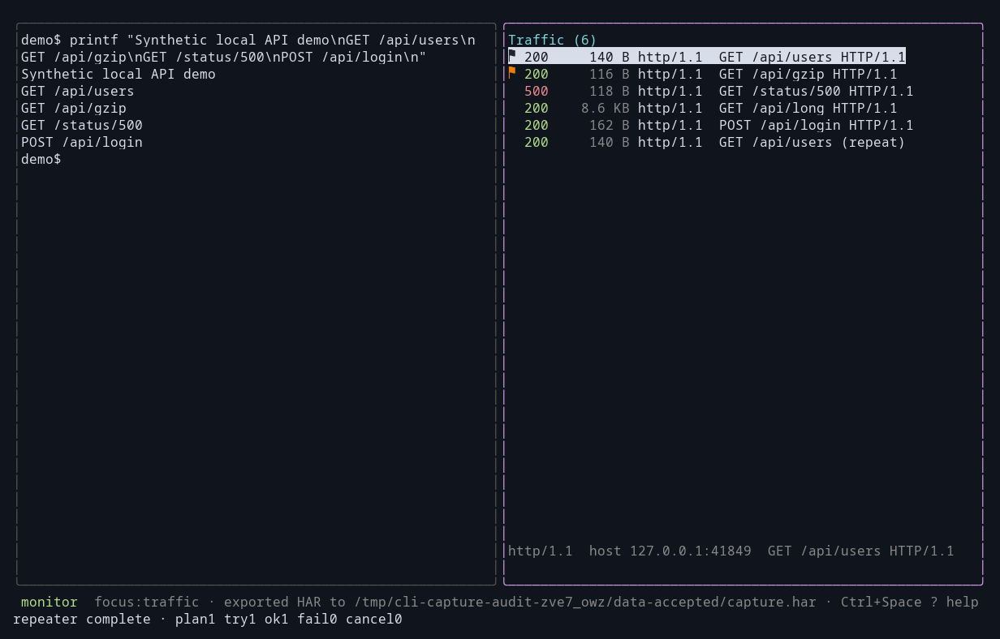

# Exporting

Exports use the data directory: `~/.cli-capture` by default, or the path from `-dir`. Theme and keybinding configuration use a separate directory.

| What | Key | File |
|---|---|---|
| Session, all flows as JSON | `Ctrl+Space s` | `session.json` |
| HAR 1.2, all flows | `Ctrl+Space h` | `capture.har` |
| Flagged flows as text | `Ctrl+Space f` | `flagged.txt` |
| One flow as text | `s` in detail | `flow-<id>.txt` |
| One flow as a curl command | `c` in traffic | `flow-<id>.curl` |

The status area reports the output path. These keys are defaults. Help and footer hints reflect the effective configuration.

## curl

`c` writes the selected request as a runnable `curl` command with its method, URL, headers, and body.


## HAR

`Ctrl+Space h` writes the capture as HAR 1.2 for browser tools and other HTTP clients.



## Sessions

`Ctrl+Space s` saves every captured flow as JSON. `-load` restores those rows immediately, before new traffic arrives:

```bash
cli-capture -load ~/.cli-capture/session.json -- some-cli
```

Loaded rows support detail, navigation, filters, flags, sorting, export, and resend. Flags survive the save/load cycle.

Session JSON retains complete stored bodies and raw bytes, regardless of terminal preview limits. This includes binary data that text export represents only by size.

WebSocket session entries retain direction, opcode, timestamp, payload bytes, and injection metadata. Successful injections appear once. Failed injection attempts do not create successful message entries.

## Text and display limits

The detail view supports expanded and raw previews. A limit notice identifies abbreviated terminal content. The preview does not change stored data or export limits.

Text export includes decoded text bodies and WebSocket direction, timestamp, and injection provenance. Binary bodies use a byte-count description. For complete stored binary content, use session JSON.

## These files are secrets

CAUTION: Review exports before you share them. Export does not redact credentials, cookies, tokens, or request bodies.

Treat the data directory as sensitive. Session JSON and HAR contain captured content beyond the visible terminal preview.
