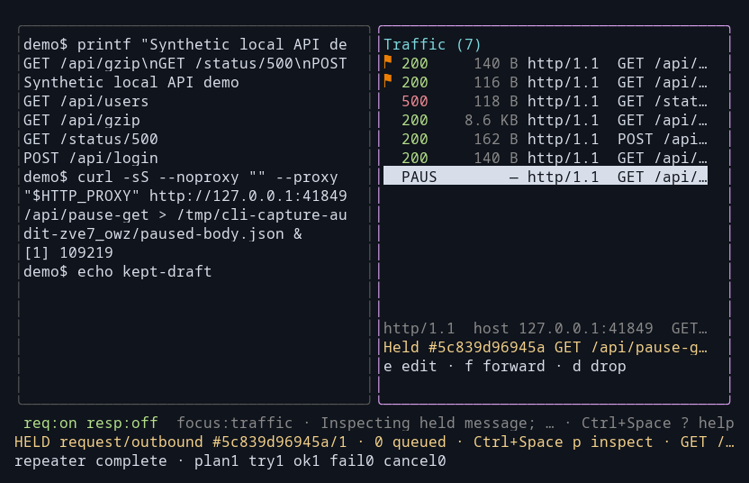
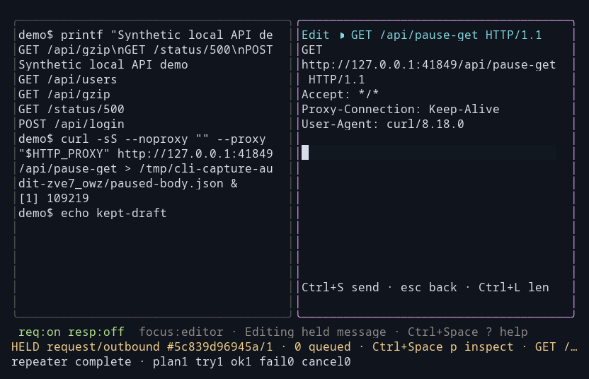

# Intercepting & tampering

Interception is **off by default**. cli-capture records traffic until you arm request interception, response interception, or both.

## The loop

1. Press `Ctrl+Space i` to arm requests, or `Ctrl+Space r` to arm responses.
2. Wait for an [in-scope](scope.md) message.
3. Press `Ctrl+Space p` to inspect the held message.
4. Press `f` to forward it, `d` to drop it, or `e` to edit it.

The status area identifies the held flow, message direction, pause identity, and queued count. New pauses do not change keyboard focus or discard drafts.



The pause actions apply to the **active held message**, not the selected traffic row. The held-message prompt identifies that target separately.

Later pauses wait in arrival order. Each decision resolves one pause, including separate requests and responses on the same flow.

`Ctrl+Space p` and Escape return from inspection to the previous view. A decision also restores that view. Unrelated connections and terminal input remain available.

## Editing

Press `e` to open the held message. The editor normalizes HTTP/1 header display without changing the original message bytes.

| Key | Action |
|---|---|
| `Ctrl+S` | forward the edited message |
| `Ctrl+L` | repair HTTP/1 `Content-Length` from the actual body byte count |
| `Ctrl+R` | clear the body for explicit text replacement |
| `esc` | close the editor and leave the message held |



An unchanged send preserves the original bytes. Header-only edits preserve the original body, including binary data and line endings.

Bodies that the text editor cannot represent use a marked placeholder. The placeholder is not the transmitted body. `Ctrl+R` explicitly replaces that retained body with new text.

Normal sends do not repair incorrect `Content-Length` values. This permits deliberate malformed-message experiments. `Ctrl+L` repairs the byte count and removes duplicate length fields.

Global leader commands remain available in the editor. Pane switches and the help overlay preserve the draft and cursor.

## What "edit" means per protocol

| Protocol | Granularity |
|---|---|
| HTTP/1.1 | full request or response, including headers and body |
| HTTP/2 (unary) | body only, buffered end to end |
| gRPC | body per message, in flight |
| WebSocket | data-frame payload, plus live injection |

HTTP/2 and gRPC body editors do not apply HTTP/1 header normalization. HTTP/2 header editing remains unavailable.

## WebSocket interception and injection

Request interception controls client-to-server data frames. Response interception controls server-to-client data frames. Both directions obey the configured scope. Handshake and control-frame behavior remain unchanged.

In the traffic pane, select a live WebSocket flow. Press `n` for client-to-server injection or `N` for server-to-client injection.

A successful injection appears once in the capture with its direction, opcode, timestamp, payload, and injection marker. An ordinary echo remains a separate message. Injections do not intercept themselves.

If the session closes or the write fails, the editor retains the draft and displays the error. Failed injections do not appear as successful capture entries.

## Scope keeps it manageable

Without a scope restriction, armed interception can hold every matching message.

```bash
# Pause only the selected API paths.
cli-capture -scope 'path:/v1/*' -- some-cli
```

See [scope](scope.md) for the grammar and precedence rules.

## Limits worth knowing

- HTTP/2 header editing remains unavailable.
- The editor supports text replacement, not arbitrary binary editing. Unchanged binary bodies remain intact.
- Non-intercepted HTTP/2 response bodies stream without capture buffering. Response interception retains those bodies for inspection.
- Certificate-pinned targets cannot use TLS interception. See [getting started](getting-started.md#when-nothing-shows-up).
