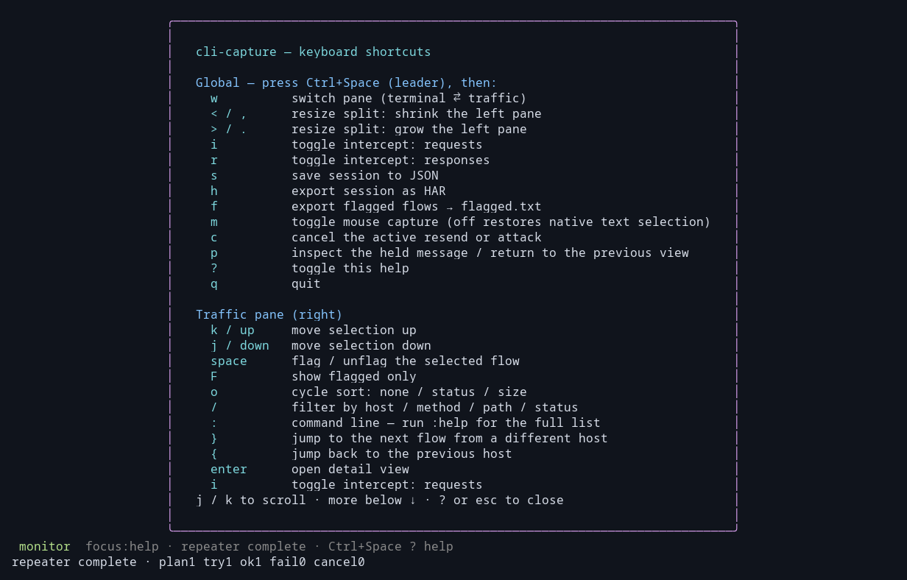

# Keybindings

The terminal pane forwards ordinary keys to the target. The global leader is
**`Ctrl+Space`**, followed by a command key. The leader works in every view,
including editors, prompts, Repeater, and help.

Press the leader twice to send its literal byte to the terminal. Other views
consume the repeated leader without inserting text. Escape cancels a pending
leader. An unknown command key does not reach the target or change a draft.

Every binding below is a default. See [configuration](configuration.md#keybindings)
for overrides. Footer hints and help show the effective bindings.

Press **`Ctrl+Space ?`** for help from any view. Plain `?` opens help in the traffic list:

## Global — `Ctrl+Space`, then:

| Key | Action |
|---|---|
| `w` | switch pane (terminal ⇄ traffic) |
| `<` / `>` | resize the split: shrink / grow the left pane |
| `i` / `r` | toggle intercept: requests / responses |
| `p` | inspect the held message, or return to the previous view |
| `c` | cancel the active resend or Repeater job |
| `s` | save session to JSON |
| `h` | export session as HAR |
| `f` | export flagged flows → `flagged.txt` |
| `m` | toggle mouse capture |
| `?` | toggle help |
| `q` | quit |
| `Ctrl+Space` | send a literal NUL byte to the target, from the terminal pane only |

## Terminal pane (left)

Ordinary keys reach the target unchanged, including `Ctrl+A`. Only the configured leader is reserved.

## Traffic pane (right)

Plain keys — no leader needed, because this pane never forwards to the target.

| Key | Action |
|---|---|
| `j` / `k` (or `↓` / `↑`) | move the selection; the list scrolls to follow |
| `space` | flag / unflag the selected flow |
| `F` | show flagged only |
| `o` | cycle sort: none → status → size |
| `/` | filter by host / method / path / status / protocol |
| `:` | open the [command line](#the--command-line) |
| `}` / `{` | jump to the next / previous host in the list |
| `enter` | open the detail view |
| `i` / `r` | toggle intercept: requests / responses (same as the leader form) |
| `e` / `f` / `d` | edit / forward / drop the **active held message**, not the selected row |
| `x` | start an asynchronous resend to the selected origin |
| `R` | open the flow in the [Repeater](repeater.md) |
| `c` | export the selected flow as a curl command |
| `n` / `N` | inject a WebSocket frame (client→server / server→client) |
| `?` | toggle help |

## Vim-style motions

These work in the traffic pane only, so a count or a motion can never reach a
target app that is itself running vim. They are built into the pane rather than
bound through the keymap, because a count is a prefix and `gg` is a sequence —
neither is a single key the keymap can name. (`}` and `{` *are* single keys, so
they are ordinary bindings and can be rebound like any other.)

For `}` and `{`, a host is the TLS SNI name when present; otherwise it is the
requested hostname without its port. Consecutive flows for that host form one
jump group.

| Keys | Motion |
|---|---|
| `{count}` | repeat the next motion — `5j`, `3k`, `2}` |
| `gg` / `G` | first / last flow |
| `{count}G`, `{count}gg` | jump to that row — `12G`, `5gg` |
| `esc` | discard a half-typed count |

The motion rows shown by `?` follow the same availability rules: claiming `g`
removes `gg`, claiming `G` removes `G` and `{count}G`, and claiming any digit
removes counted-motion rows. Counted-repeat examples use the effective movement
and host-jump bindings, and the repeat row disappears if all four actions are
unbound.

A pending count (or a lone `g` waiting for its pair) shows in the traffic pane
header, so a half-typed motion is never invisible. It is discarded whenever
focus leaves the list — the leader key, the terminal pane, or `esc` — so a count
you started and abandoned can never attach itself to a later keystroke.

## The `:` command line

By default, `:` opens a command line in the traffic pane. Rebinding
`flow.command` changes that opener; fully unbinding it removes the command table
from `?` because the commands are no longer reachable. The command line exists
to reach actions that do not deserve a keybinding, and every command calls the
same code as its key, so `:curl` and `c` do exactly the same thing.

| Command | Does |
|---|---|
| `:filter <query>` | set the flow filter; no argument clears it |
| `:sort none\|status\|size` | sort the list |
| `:export har\|flagged` | **write flows to disk** — `capture.har` or `flagged.txt` |
| `:har` | shorthand for `:export har` |
| `:flagged` | show only flagged flows, same as `F` (`:only`) |
| `:curl` | write the selected flow to `flow-<id>.curl` |
| `:resend` | resend the selected flow |
| `:cancel` | cancel the active resend or Repeater job |
| `:flag` | toggle the flag on the selected flow |
| `:w` | save the session (`:write`, `:save`) |
| `:help` | open the help overlay |
| `:q` | quit (`:quit`) |

Each command has a short form, typed after the `:` — these are abbreviations of
the *command*, not references to pane keys, and several deliberately differ from
the key that does the same job. Aliases also appear beside canonical command
names in the in-app help overlay:

| Short | Full |
|---|---|
| `:f` | `:filter` |
| `:y` | `:curl` |
| `:x` | `:resend` |
| `:h` | `:help` |
| `:write`, `:save` | `:w` |
| `:quit` | `:q` |

> Do not read those as pane keys. In the traffic pane `f` **forwards a PAUSED
> flow** to its origin, `h` under the leader exports HAR, and `y` is unbound.
> `:f` and `f` do different things.

Enter runs the command. Escape cancels it. Global leader commands remain
available in the prompt. Unknown commands report an error in the status area.

`:flagged` toggles the *view*, matching the plain-English reading and the `F`
key. Writing flagged request and response bodies to `flagged.txt` — credentials
included — is spelled out in full as `:export flagged`, so the destructive one is
never the shorter thing to type.

Commands stay available even when the equivalent key has been unbound in
[configuration](configuration.md) — that is the point of having a command line.

## Detail view (`enter`)

| Key | Action |
|---|---|
| `j` / `k`, arrows, page keys, mouse wheel | scroll |
| `v` | switch expanded and raw stored representations |
| `s` | save this flow to a `.txt` file |
| `esc` / `q` | back to the list |

The detail header separates HTTP response status from capture lifecycle.
Representation limits are explicit. The view rewraps after a resize and retains
the scroll position, including a bottom anchor. Session JSON retains complete
stored bytes even when the terminal preview is abbreviated.

## Editor (while [intercepting](intercepting.md))

| Key | Action |
|---|---|
| `Ctrl+S` | forward / send the edited message |
| `Ctrl+L` | repair HTTP/1 `Content-Length` from the body byte count |
| `Ctrl+R` | clear the retained body for explicit text replacement |
| `esc` | close the editor and leave the message held |

## Repeater (`R`)

| Key | Action |
|---|---|
| `Tab` | cycle focus: request → payloads → response |
| `Ctrl+O` | cycle attack mode: single / sniper / battering-ram / pitchfork / cluster-bomb |
| `Ctrl+S` | start a single request or attack job |
| `Ctrl+R` | clear the retained body for explicit text replacement |
| `esc` | close the view without canceling its job |

Pane switches and help preserve modal drafts and focus. The global
`Ctrl+Space c` cancellation command remains available after the Repeater closes.

## The status bar

The chrome identifies keyboard focus, interception state, and effective global
help. The action result uses a bounded row and cannot expand the terminal frame.

A separate held-message row identifies direction, flow, pause identity, and
queued count. Its target can differ from the selected traffic row. A job row
shows manual-request progress and cancellation even outside the Repeater.

At narrow sizes, status and byte-count columns take priority over request text.
Below 60 columns or 16 rows, the interface displays a bounded resize notice.
