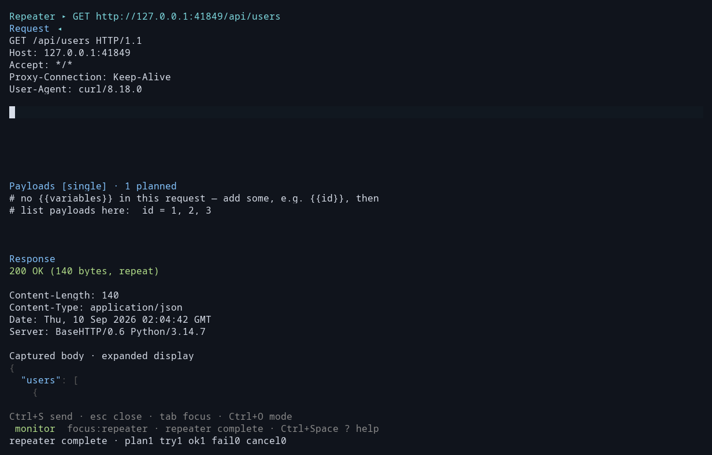
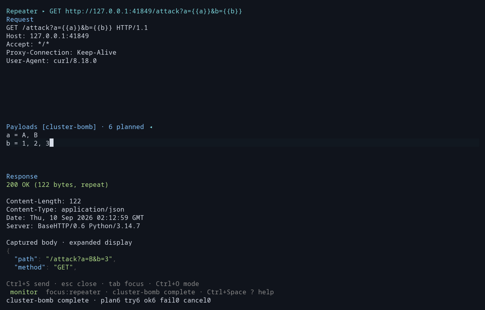
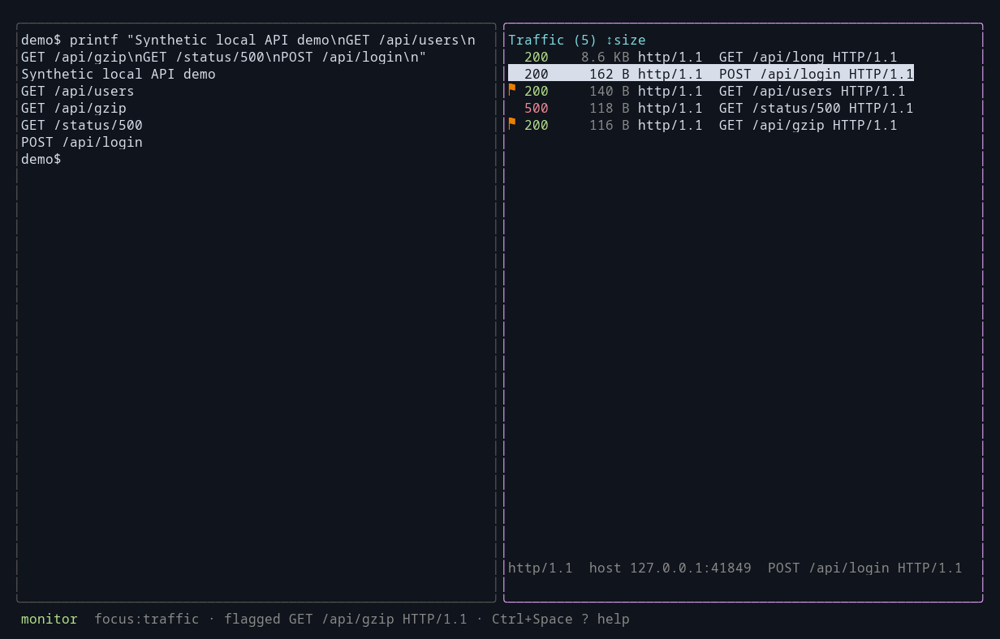

# Repeater & attacks

In the traffic pane, press `R` to open the selected request. Edit the request. Then press `Ctrl+S` to send it. The response appears inline.



`Tab` cycles request, payload, and response focus. Escape closes the view without canceling an active job. Global pane and help commands preserve the editor draft.

HTTP/1.1, HTTP/2, and gRPC request/response flows support replay. WebSocket streams and raw TCP flows do not.

For an unchanged resend, press `x` in the traffic list. This starts the same cancellable background job and captures its result as a flow.

## Request editing

The request editor preserves the original body bytes during unchanged sends and header-only edits. Unsafe binary bodies use a placeholder, not a text conversion.

`Ctrl+R` clears the body for explicit text replacement. Malformed request lines and headers produce an error before any request starts. Repeater uses the HTTP client for transport and framing.

## Variables

Write `{{name}}` in the URL, a header value, or the body. Names accept letters, digits, `_`, `.`, and `-`. Whitespace inside the braces is permitted, as in `{{ name }}`.

An unfilled variable retains its literal `{{name}}` form. Each payload definition uses one line in the payloads pane:

```text
user = ada, grace, alan
role = admin, guest

# Blank lines and comments are ignored.
```

Values are comma-separated and trimmed. In **single** mode, each variable uses the first value in its list.

## Attack modes

`Ctrl+O` cycles the mode. Only variables with a payload list become insertion points. Other variables retain their baseline value.



| Mode | Pairing | Planned requests |
|---|---|---|
| `single` | one request with baseline values | 1 |
| `sniper` | one position at a time | sum of all list lengths |
| `battering-ram` | the same payload in every position | length of the first list |
| `pitchfork` | advance all lists together | length of the shortest list |
| `cluster-bomb` | every combination | product of all list lengths |

The Repeater displays the planned count before execution. An overflowing count produces an error before expansion.

CAUTION: Validate the planned count before you press `Ctrl+S`. Three lists of ten values produce 1,000 cluster-bomb requests against the destination.

## Progress and cancellation

Resend and Repeater share one manual job slot. A second start reports the active job instead of creating overlapping traffic.

The job row remains visible outside the Repeater. It shows planned, attempted, successful, failed, and canceled work. A canceled job does not report ordinary completion.

Press `Ctrl+Space c` to cancel from any view. The traffic command `:cancel` performs the same action. Cancellation stops the active HTTP request and prevents later attack requests.

Closing the Repeater does not cancel the job. Application shutdown cancels and waits for the worker. Results from an older job do not replace a newly opened Repeater response.

## Reading the results

Each successful request becomes a captured flow with its payload label. Navigation, filtering, help, and terminal input remain available while the job runs.

Press `o` to cycle sorting by status or size. The row keeps protocol, response status, and response size visible before clipping the request target.



Press `space` to flag a result. Press `Ctrl+Space f` to export flagged flows to `flagged.txt`. See [exporting](exporting.md).
