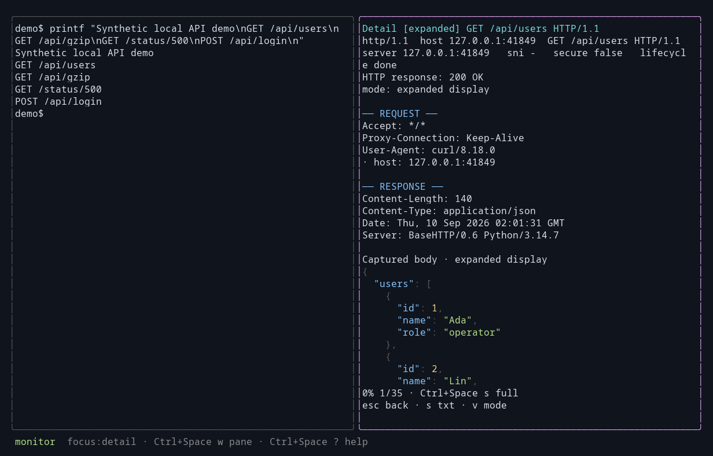
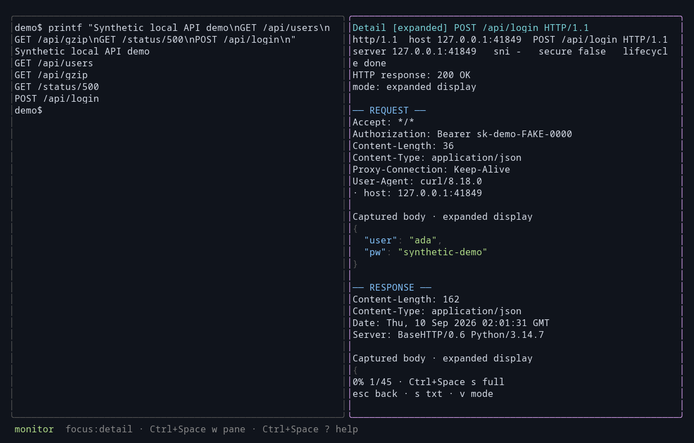
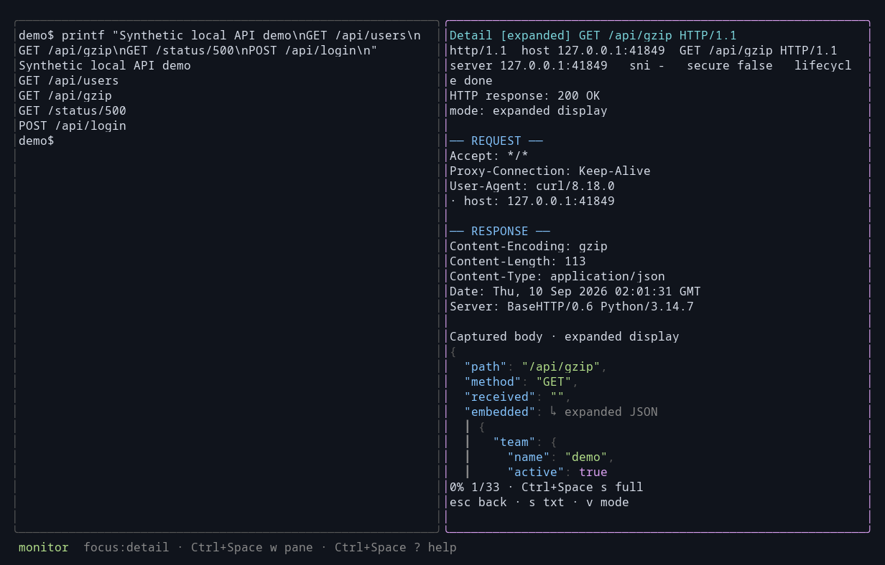
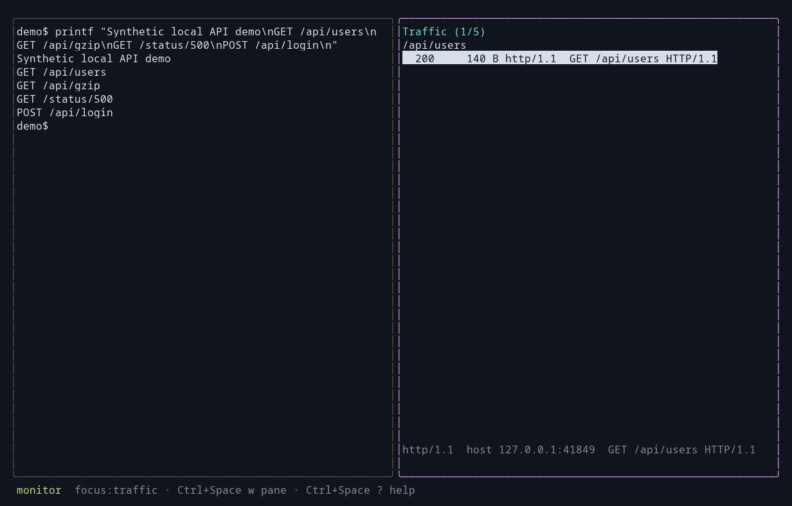
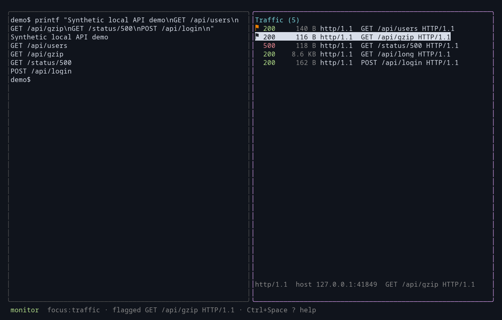
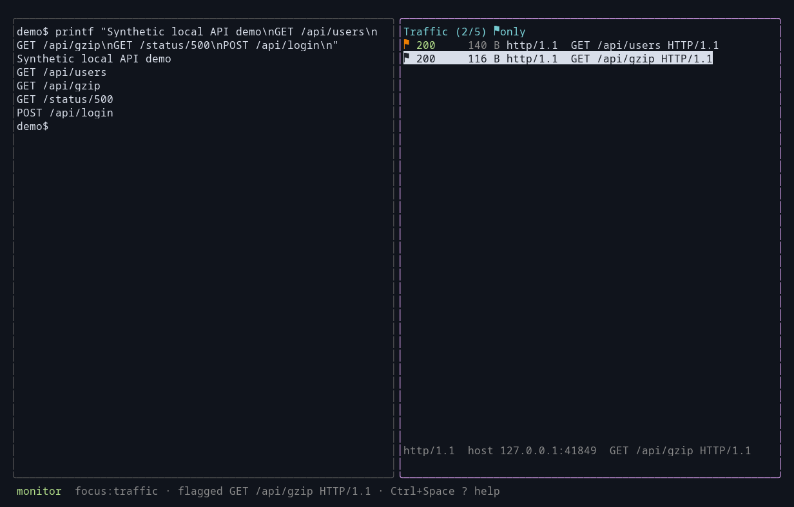
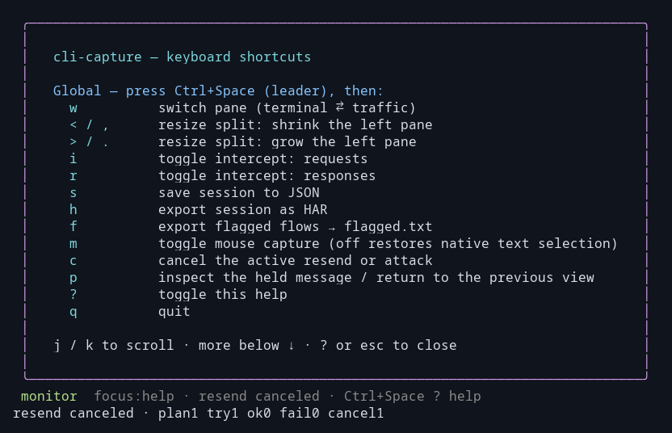
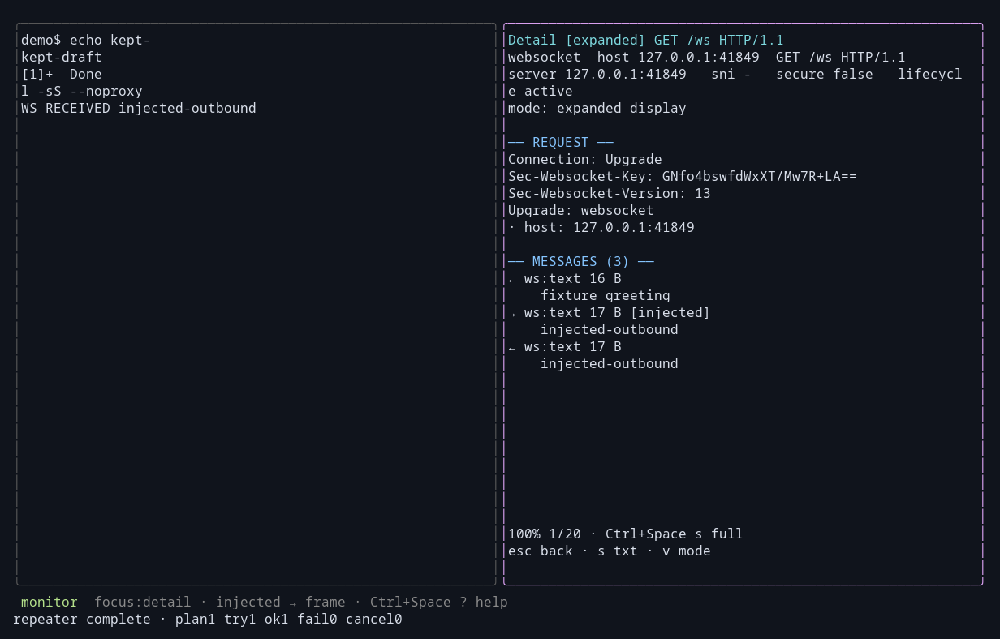
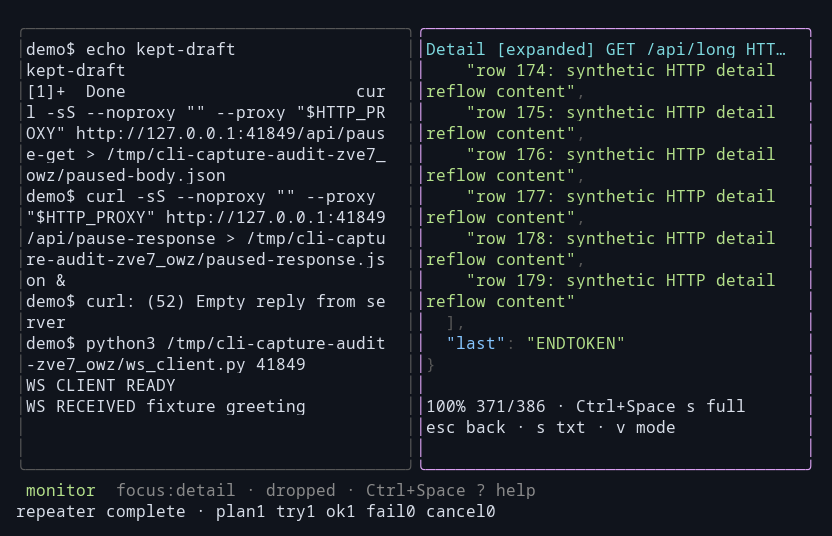
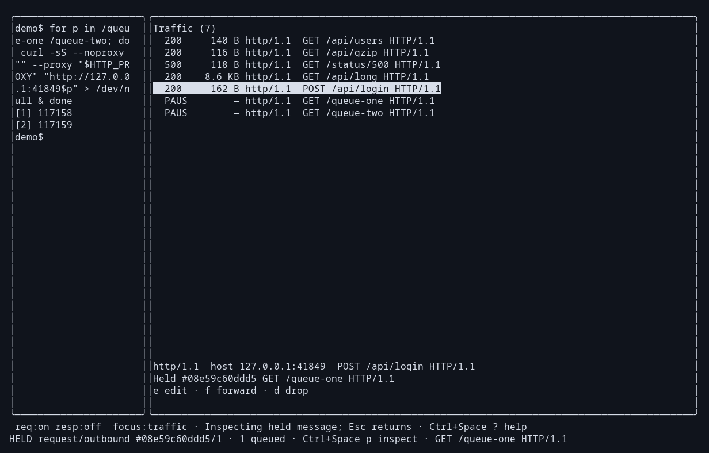

# cli-capture — a visual tour

These images come from real PTY runs against local HTTP and WebSocket fixtures. All credentials and payloads are synthetic. Some views use a saved capture to exercise startup without new traffic.

The default global leader is **`Ctrl+Space`**. Press **`Ctrl+Space ?`** for help from any view. Explicit leader overrides remain available.

See [getting started](getting-started.md), [keybindings](keybindings.md), [configuration](configuration.md), [intercepting](intercepting.md), [Repeater](repeater.md), and [exporting](exporting.md) for the written guides.

## The split-pane monitor

The target runs in the left pane. The right pane shows captured traffic. Rows keep protocol, response status, and response size before clipping request text.

## Request and response detail

Press Enter on a flow to open detail. The header separates HTTP response status from capture lifecycle. Expanded view formats and highlights JSON.

## Request headers and body

The same detail view shows the captured request, including headers and body.

## Decompression and raw display

Expanded view decodes `gzip`, `deflate`, `br`, and `zstd`. The original encoding header remains visible. Press `v` to switch to raw stored content.

## Filter the list

Press `/` to filter by host, method, path, status, or protocol. A zero-match view identifies the active filter instead of implying an empty capture.

## Flag flows

Press Space to flag the selected flow. Flags survive a session save/load cycle.

## Show only flagged flows

Press `F` to restrict the list to flagged flows.

## Sort results

Press `o` to cycle none, status, and size sorting. Status and byte-count columns remain readable at narrow widths.

## Repeater with an inline response

Press `R` to open a request. Press `Ctrl+S` to start the job. `Tab` cycles request, payload, and response focus.

## Attack modes

`Ctrl+O` cycles single, sniper, battering-ram, pitchfork, and cluster-bomb. The planned count appears before execution. The job row reports actual progress.

## A held request

Press `Ctrl+Space i` to arm requests, or `Ctrl+Space r` to arm responses. New pauses do not change keyboard focus. Press `Ctrl+Space p` to inspect the active held message.

## Edit without changing untouched bytes

Press `e` to edit the held message. An unchanged send preserves its original bytes. Header-only edits preserve its body. `Ctrl+R` explicitly replaces the body with text.

`Ctrl+L` repairs HTTP/1 `Content-Length`. Normal sends do not repair intentionally incorrect lengths. Escape closes the editor and leaves the message held.

## Effective help

`Ctrl+Space ?` opens help from editors, prompts, detail, terminal, and Repeater. The overlay displays configured bindings. Closing it restores the previous view.

## Export a curl command

Press `c` in traffic to export the selected request.

## Export the session

`Ctrl+Space h` exports HAR. `Ctrl+Space s` saves session JSON, including complete stored bytes and WebSocket injection metadata.

## Cancel a request without blocking the interface

`Ctrl+Space c` cancels the active manual job from any view. `:cancel` works after the Repeater closes. The job row distinguishes cancellation from completion.

## WebSocket injection history

Successful injections appear once with direction and injection provenance. Session entries retain timestamps and opcodes. Server echoes remain separate messages. Closed-session and failed writes retain the editor draft instead of recording false success.

## Narrow detail at the bottom

Detail rewraps after a resize. A bottom-anchored view stays at the bottom, with the final content and footer visible at 80×24.

## Queued pauses without color

The held-message row identifies its flow, direction, pause identity, and queued count. The selected row can differ from that target. These distinctions remain visible in the `none` theme.

## Not pictured

The automated checks cover gRPC body editing and protocol byte preservation. Transparent Linux capture requires separate network setup and is outside this terminal audit.
